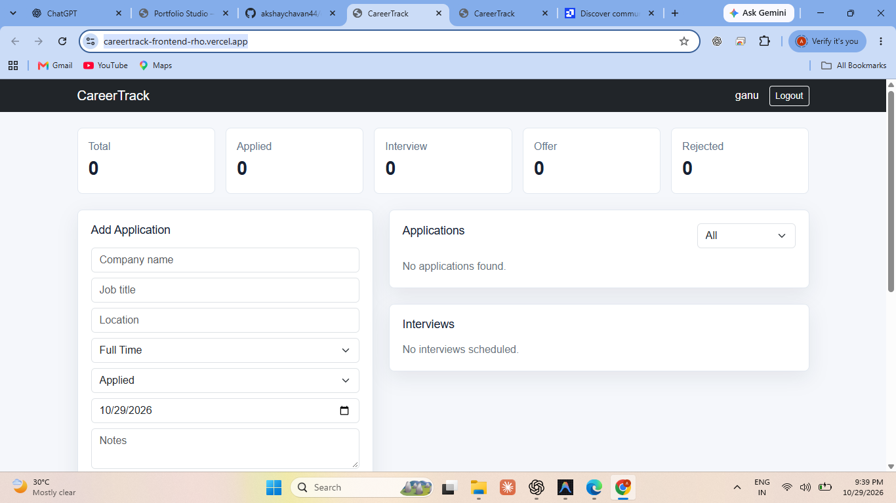

# CareerTrack - Full Stack Job Application Tracker

CareerTrack is a resume-ready full-stack project built with React, Spring Boot, JWT authentication, and MongoDB.

## Live Demo

[Open CareerTrack](https://careertrack-frontend-rho.vercel.app/)

## Dashboard Preview



## Tech Stack

- Frontend: React, Vite, Bootstrap, Axios
- Backend: Spring Boot, Spring Security, JWT, Spring Data MongoDB
- Database: MongoDB
- Tools: STS, Maven, Postman, VS Code

## Features

- User registration and login
- JWT-based protected APIs
- Add, edit, delete job applications
- Track status: Applied, Interview, Offer, Rejected
- Add interview details
- Dashboard statistics
- Responsive UI

## How To Run

Use Java 17 or later, Maven, and Node.js 22.12 or later.

### 1. Start MongoDB

Make sure MongoDB is running locally:

```bash
mongodb://localhost:27017
```

The backend will automatically use/create this database:

```bash
careertrack
```

### 2. Run Backend

Open this folder in STS:

```bash
careertrack-backend
```

Then run:

```bash
mvn spring-boot:run
```

Backend URL:

```bash
http://localhost:8080
```

### 3. Run Frontend

Open another terminal:

```bash
cd careertrack-frontend
npm install
npm run dev
```

Frontend URL:

```bash
http://localhost:5173
```

Development uses `http://localhost:8080/api` through `.env.development`.
Production keeps the hosted backend default. To point development elsewhere,
set `VITE_API_BASE_URL` in `.env.development.local` or in the shell environment.

Set `APP_CORS_ALLOWED_ORIGIN` on the backend to the frontend origin. Multiple
origins are comma-separated. Set `JWT_SECRET` to your deployment's signing secret.

## Automated checks

```bash
npm ci
npm --prefix careertrack-frontend ci
mvn -f careertrack-backend/pom.xml clean package
npm run build
npx playwright install chromium
npm run test:e2e
```

The end-to-end suite starts its own MongoDB, backend on port 18080, and frontend
on port 15173. It verifies registration/login, CRUD, validation, ownership,
dashboard statistics, interview cleanup, CORS, session handling, duplicate
submissions, responsive layouts, and the portfolio menu. It stops its processes
and discards its test database afterward. Its first run downloads a MongoDB binary.
Use `QA_API_PORT` and `QA_UI_PORT` to select other test ports. Set
`QA_BROWSER_CHANNEL=chrome` to use an installed Chrome instead of bundled Chromium.
Java must be available through `JAVA_HOME` or `PATH`.

## Jeweller profile integration

Basic CareerTrack registration needs a name, email, and password. API clients can
optionally submit `storeName` to request a jeweller profile. In that case, the backend posts
`storeName`, `email`, and the submitted `password` to the jeweller API over HTTPS.
CareerTrack stores only the encoded password; the submitted password is used for this
request without logging or saving it in plaintext. Configure
`JEWELER_API_KEY` as a secret environment variable on the backend hosting service
(Render), then redeploy. Never put the key in a `VITE_` variable or commit it.
`JEWELER_API_URL` optionally overrides the default endpoint:
`https://jewelry-one-ebon.vercel.app/api/v1/jewelers`.

Successful creation saves the store name and a creation flag in MongoDB before
returning the registration token. If the API fails, the owner can retry registration
with the same email, password, and store name to complete the pending profile. Duplicate completed
registrations are rejected. HTTP 409 requires the administrator to link the existing
profile. Login requires only email and password and never calls the jeweller API.

Profiles created before password forwarding was enabled are not updated automatically;
those accounts need a password reset in the jewellery software.

The saved flag prevents repeat requests after a confirmed success. Exactly-once
creation across multiple backend instances or a timeout after remote creation
requires idempotency support from the external API; its contract does not specify
that support.

Run backend checks with `mvn test`, frontend checks with `npm run build`, and the
deployment checks with `API_URL` set to the backend `/api` URL and
`CHECK_AUTH_ERRORS=true` using `node scripts/smoke-test.mjs`. The smoke check creates
a basic test account when registering a new account. Set `TEST_STORE_NAME` only
when you intend to test external jeweller profile creation as well. Use a test
database for smoke tests; the account remains after its application/interview
records are removed. The isolated end-to-end suite discards all its test data.
Set `FRONTEND_ORIGIN` for smoke tests against a deployment; it defaults to
`http://localhost:5173` and must match a configured backend CORS origin.

## Resume Line

Built CareerTrack, a full-stack job application tracker using React.js, Spring Boot, Spring Security, JWT, and MongoDB to manage job applications, interview schedules, application statuses, and dashboard analytics.

## Resume Bullet Points

- Developed a full-stack job tracking platform using React.js, Spring Boot, and MongoDB with secure JWT-based authentication.
- Implemented REST APIs for user authentication, job application management, interview tracking, status filtering, and dashboard statistics.
- Designed MongoDB collections for users, applications, and interviews to manage job search data efficiently.
- Built a responsive frontend using React.js, Bootstrap, and Axios for managing applications and interview schedules.
